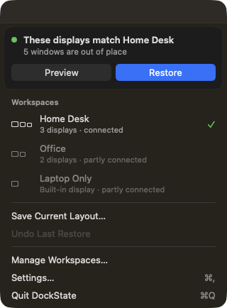
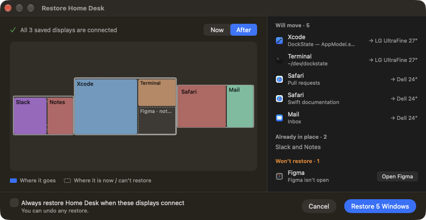
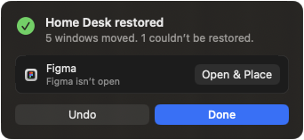
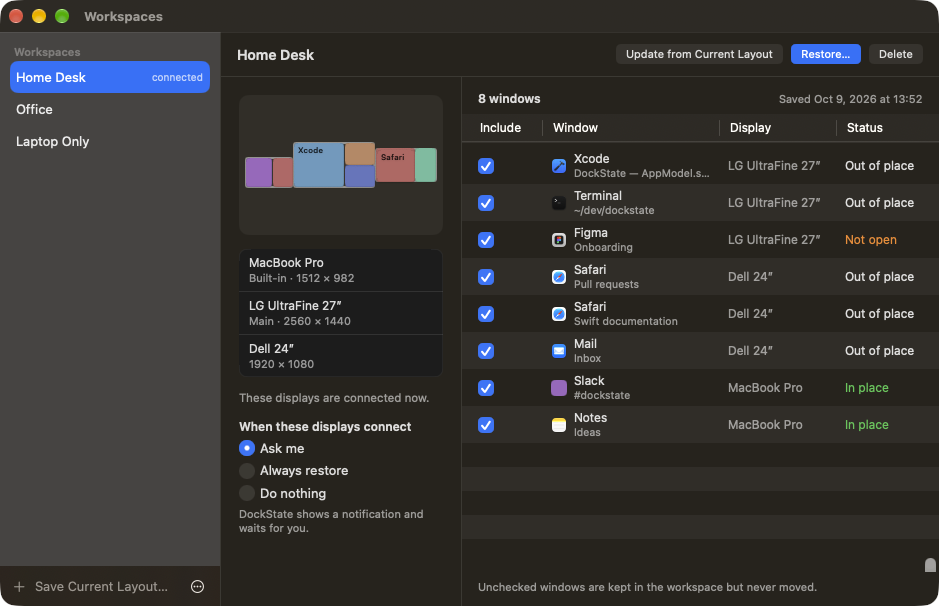
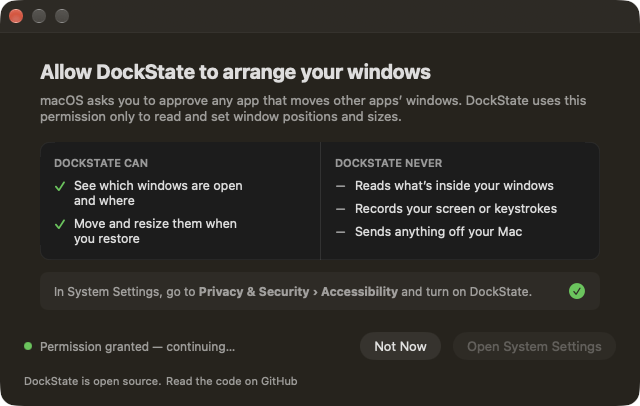
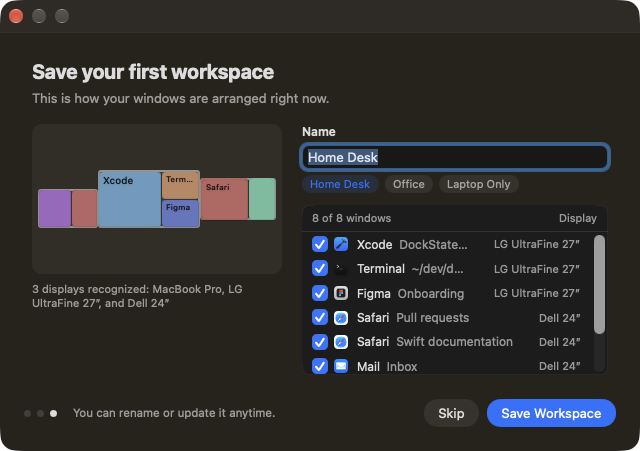
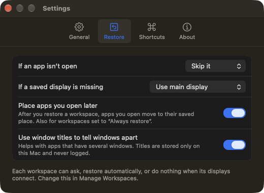
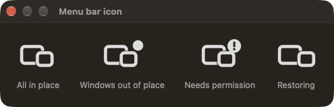

<p align="center">
  
</p>

<h1 align="center">DockState</h1>

<p align="center">
  <b>Your workspace, right where you left it.</b><br>
  A tiny, private menu bar app that remembers where your windows go for every display setup — and puts them back when you reconnect.
</p>

<p align="center">
  <a href="https://github.com/KEREM-BAS/DockState/releases"></a>
  
  
  <a href="LICENSE"></a>
  <a href="https://github.com/KEREM-BAS/DockState/actions/workflows/ci.yml"></a>
</p>

<p align="center"><a href="README.tr.md">Türkçe</a></p>

---

You plug your MacBook into two monitors. Your IDE goes on the big one, the browser on the other, chat on the laptop. You unplug and leave. macOS piles everything onto the laptop screen. When you come back and plug in again, **nothing goes back where it was** — so you drag a dozen windows around, again, several times a week.

DockState fixes that one problem and nothing else:

1. **Save** — arrange your windows once and save them as a workspace (*Home Desk*, *Office*, *Laptop Only*…).
2. **Reconnect** — DockState recognizes the exact display setup, even if a monitor moved to another port.
3. **Restore** — see what will move, restore in one click, **undo** anytime.

Nothing moves without you saying so.

## Screenshots

<table>
<tr>
<td width="38%" valign="top"><br><sub><b>Menu bar.</b> When your displays match a saved workspace, DockState offers it — nothing more.</sub></td>
<td valign="top"><br><sub><b>Preview.</b> Exactly what will move, what's already in place and what can't be restored — before anything moves.</sub></td>
</tr>
<tr>
<td valign="top"><br><sub><b>Result.</b> Success first, then what's missing with a one-click fix. Undo is always there.</sub></td>
<td valign="top"><br><sub><b>Manage.</b> Displays, automation per workspace, and which windows to include.</sub></td>
</tr>
<tr>
<td valign="top"><br><sub><b>Permission, explained plainly.</b> What DockState can do, and what it never does.</sub></td>
<td valign="top"><br><sub><b>First workspace.</b> A suggested name and every window pre-selected — one click.</sub></td>
</tr>
<tr>
<td valign="top"><br><sub><b>A few clear choices.</b> Everything else has a sensible default.</sub></td>
<td valign="top"><br><sub><b>The menu bar icon tells you</b> when windows are out of place, when permission is missing, and when a restore is running.</sub></td>
</tr>
</table>

<sub>Screenshots use a fictional desk (Debug builds: <code>-DockStateDemo YES</code>). Turkish versions are in <a href="README.tr.md">README.tr.md</a>.</sub>

## Features

- **Workspaces per display setup** — save as many as you like, rename them, update them from the current layout, exclude individual windows. Export and import them as a file (backup, new Mac).
- **Recognizes your desk, not just "2 displays"** — monitors are identified by EDID vendor/model/serial, display UUID and arrangement, so a monitor on a different port or a changed resolution is still *your* monitor, and two identical monitors are told apart by position. An extra display (Sidecar, a projector, opening the lid) doesn't stop your desk from being recognized.
- **Preview before anything moves** — a Now / After map plus exact lists: *will move*, *already in place*, *won't restore (and why)*.
- **Undo** — puts every window back where it was before the restore. Windows you've moved since are left alone.
- **Partial failures are fine** — an app that isn't open or a window that was closed is reported with a reason (and an *Open & Place* button), and never stops the rest.
- **You choose the automation** — per workspace: *Ask me* (notification, default), *Always restore*, or *Do nothing*. Automatic restores happen only when the display setup actually changes — never on a plain wake or unlock.
- **Apps you open later** — after you restore a workspace, an app you open afterwards (Slack ten minutes later) goes to its saved place too. With its own Undo.
- **Menu bar first** — stays out of the way; the icon shows a dot when windows are out of place and a badge when permission is missing.
- **Keyboard shortcuts, if you want them** — save, restore matching workspace, undo. Off by default (global shortcuts take over the same keys in every app); record your own in Settings.
- **English and Türkçe**, with an in-app language switch. More languages welcome.

## Privacy

- **Everything stays on your Mac.** No account, no cloud, no analytics.
- **No network requests** unless you turn on *Settings › General › Check for updates automatically* (or press *Check Now*). DockState then reads this repository's public releases feed, at most once a day, and sends nothing about you.
- DockState needs **Accessibility** permission — the macOS permission for moving other apps' windows. It reads window positions, sizes and titles, and sets positions and sizes. It never reads window contents.
- **No Screen Recording permission.** Previews are drawn as schematic maps, not screenshots.
- Window titles help tell multiple windows of the same app apart. They are kept only in `~/Library/Application Support/DockState/workspaces.json`, are never logged, and can be turned off in *Settings › Restore* (existing titles are deleted and new ones aren't stored).
- *Copy Diagnostics* (Settings › About) produces a bug-report summary without window titles, app names or serial numbers.

## Install

1. Download the latest **`DockState-x.y.z.dmg`** from [Releases](https://github.com/KEREM-BAS/DockState/releases).
2. Open it and drag **DockState** to **Applications**.
3. Launch DockState and follow the three-step setup.

Releases built with a Developer ID are signed and notarized by Apple and open normally. Builds named `…-unsigned.dmg` are not notarized, so macOS blocks the first launch: open DockState once, then go to **System Settings › Privacy & Security** and click **Open Anyway** (on macOS 14 you can also right-click the app and choose **Open**). After updating an unsigned build, turn DockState's Accessibility permission off and on again — macOS ties it to the exact build.

**Requirements:** macOS 14 Sonoma or later, Apple Silicon or Intel.

## What DockState can and can't do

DockState uses only public Apple APIs — no private frameworks, no SIP changes. That sets honest limits:

| Situation | Behavior |
| --- | --- |
| Normal windows on the current Space | ✅ Saved and restored |
| Several windows of one app | ✅ Matched by title, size, display and order; if two windows can't be told apart, DockState **skips them rather than guess** |
| App not running | ⏭️ Reported; *Open & Place* launches it and places its window (or set *Open it first* for manual restores) |
| App opened after a restore | ✅ Placed automatically (Settings › Restore › *Place apps you open later*) |
| Window closed since saving | ⏭️ Reported as closed |
| Minimized windows | ⏭️ Left minimized and reported |
| Full-screen windows | ⏭️ Left alone (full-screen Spaces have no public API) |
| Windows on other Spaces | ❌ Not visible to public APIs; switch to that Space and restore there |
| Saved display missing | Windows go to the main display proportionally, or stay put — your choice |
| Extra display connected | ✅ Your desk is still recognized; windows go to their saved displays |
| Resolution / scaling changed | Positions and sizes are scaled to the new usable area |
| Mirrored displays | Treated as one display |
| Apps that refuse to be moved or enforce a size | Reported or accepted as-is; the rest still restore |

More detail: [docs/BEHAVIOR.md](docs/BEHAVIOR.md).

## Build from source

```bash
git clone https://github.com/KEREM-BAS/DockState.git
cd DockState
open DockState.xcodeproj        # Xcode 26 or later, then Run
```

No dependencies to install. The app is signed to run locally by default; to keep the Accessibility permission across rebuilds, sign with your own team — see [`Config/Signing.xcconfig`](Config/Signing.xcconfig).

Core logic lives in a Swift package and is tested without any permissions:

```bash
cd Packages/DockStateKit && swift test
```

An end-to-end self-test moves a throw-away test window on your real Mac — see [docs/TESTING.md](docs/TESTING.md).

## Contributing

Bug reports, translations and pull requests are very welcome — see [CONTRIBUTING.md](CONTRIBUTING.md) and [docs/ARCHITECTURE.md](docs/ARCHITECTURE.md). Please include the output of *Copy Diagnostics* in bug reports.

## License

[MIT](LICENSE) © Kerem Baş and DockState contributors.
