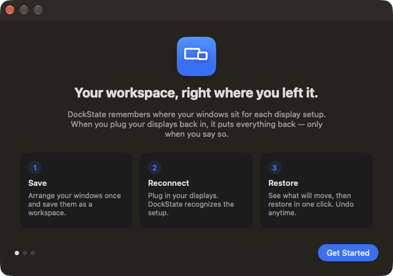

<p align="center">
  
</p>

<h1 align="center">DockState</h1>

<p align="center">
  <b>Çalışma alanınız, tam bıraktığınız yerde.</b><br>
  Her ekran düzeni için pencerelerinizin nerede durduğunu hatırlayan, yeniden bağlandığınızda onları yerine koyan küçük ve gizlilik odaklı bir menü çubuğu uygulaması.
</p>

<p align="center">
  <a href="https://github.com/KEREM-BAS/DockState/releases/latest"></a>
  
  
  <a href="LICENSE"></a>
</p>

<p align="center"><a href="README.md">English</a></p>

---

MacBook’unuzu iki monitöre bağlıyorsunuz. IDE büyük ekranda, tarayıcı diğerinde, mesajlaşma uygulamaları dizüstünde. Kabloları çıkarıp gidiyorsunuz; macOS her şeyi dizüstü ekranına yığıyor. Geri gelip tekrar bağladığınızda **hiçbir şey eski yerine dönmüyor** — ve haftada birkaç kez onlarca pencereyi yeniden sürüklüyorsunuz.

DockState yalnızca bu sorunu çözer:

1. **Kaydet** — pencerelerinizi bir kez düzenleyin ve bir çalışma alanı olarak kaydedin (*Ev Masası*, *Ofis*, *Yalnızca Dizüstü*…).
2. **Yeniden bağla** — DockState ekran düzeninizi tanır; monitör başka bir porta takılmış olsa bile.
3. **Geri yükle** — neyin taşınacağını görün, tek tıkla geri yükleyin, istediğiniz an **geri alın**.

Siz onay vermeden hiçbir pencere taşınmaz.

## Ekran görüntüleri

| İzin ekranı (Türkçe) | Hoş geldiniz |
| --- | --- |
|  |  |

## Özellikler

- **Her ekran düzeni için çalışma alanları** — istediğiniz kadar kaydedin, yeniden adlandırın, mevcut düzenden güncelleyin, tek tek pencereleri hariç tutun.
- **Yalnızca “2 ekran” değil, masanızı tanır** — monitörler EDID üretici/model/seri numarası, ekran UUID’si ve yerleşimle tanımlanır. Farklı porta takılan veya çözünürlüğü değişen monitör yine *sizin* monitörünüzdür; aynı modelden iki monitör konumlarıyla ayırt edilir.
- **Taşımadan önce önizleme** — Şimdi / Sonra haritası ve kesin listeler: *taşınacak*, *zaten yerinde*, *geri yüklenmeyecek (ve nedeni)*.
- **Geri alma** — her pencereyi geri yükleme öncesindeki yerine koyar. Sonradan sizin taşıdığınız pencerelere dokunmaz.
- **Kısmi başarısızlık sorun değil** — açık olmayan bir uygulama ya da kapatılmış bir pencere nedeniyle birlikte bildirilir (*Aç ve Yerleştir* düğmesiyle) ve diğerlerini asla durdurmaz.
- **Otomasyonu siz seçersiniz** — her çalışma alanı için: *Bana sor* (bildirim, varsayılan), *Her zaman geri yükle* veya *Hiçbir şey yapma*.
- **Klavye kısayolları** — ⌥⌘S kaydet, ⌥⌘R eşleşen düzeni geri yükle, ⌥⌘Z geri al (kapatılabilir).
- **Türkçe ve İngilizce**, uygulama içinden dil değiştirme.

## Gizlilik

- **Her şey Mac’inizde kalır.** Hesap yok, bulut yok, analitik yok, hiçbir ağ isteği yok.
- DockState, başka uygulamaların pencerelerini taşımak için macOS’un **Erişilebilirlik** iznine ihtiyaç duyar. Pencere konumlarını, boyutlarını ve (isteğe bağlı) başlıklarını okur; konum ve boyutları ayarlar. Pencere içeriklerini asla okumaz.
- **Ekran Kaydı izni gerekmez.** Önizlemeler ekran görüntüsü değil, şematik haritadır.
- Pencere başlıkları yalnızca `~/Library/Application Support/DockState/workspaces.json` içinde saklanır, asla günlüğe yazılmaz ve *Ayarlar › Geri Yükle* bölümünden kapatılabilir (mevcut başlıklar silinir).

## Kurulum

1. [Releases](https://github.com/KEREM-BAS/DockState/releases/latest) sayfasından en son **`DockState-x.y.z.dmg`** dosyasını indirin.
2. Açın ve **DockState**’i **Uygulamalar** klasörüne sürükleyin.
3. DockState’i başlatın ve üç adımlık kurulumu izleyin.

Developer ID ile imzalanan sürümler Apple tarafından notarize edilir ve normal şekilde açılır. `…-unsigned.dmg` adlı sürümler notarize değildir; ilk açılışta macOS engeller — uygulamaya sağ tıklayıp **Aç**’ı seçin veya **Sistem Ayarları › Gizlilik ve Güvenlik** bölümünden izin verin.

**Gereksinimler:** macOS 14 Sonoma veya üzeri, Apple Silicon veya Intel.

## Sınırlar

DockState yalnızca Apple’ın herkese açık API’lerini kullanır (özel framework yok, SIP değişikliği yok). Bu yüzden: başka Spaces’teki pencereler görülemez, tam ekran ve küçültülmüş pencerelere dokunulmaz, birbirinden ayırt edilemeyen pencereler tahmin edilmek yerine atlanır. Ayrıntılar: [docs/BEHAVIOR.md](docs/BEHAVIOR.md).

## Kaynaktan derleme

```bash
git clone https://github.com/KEREM-BAS/DockState.git
cd DockState
open DockState.xcodeproj        # Xcode 16 veya üzeri
cd Packages/DockStateKit && swift test
```

## Katkı

Hata bildirimleri, çeviriler ve pull request’ler memnuniyetle karşılanır — [CONTRIBUTING.md](CONTRIBUTING.md).

## Lisans

[MIT](LICENSE) © Kerem Baş ve DockState katkıcıları.
