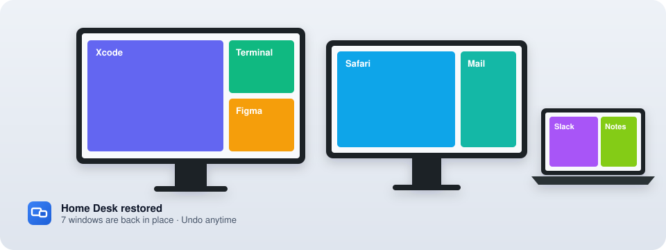
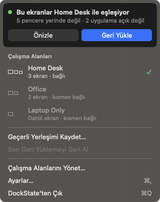
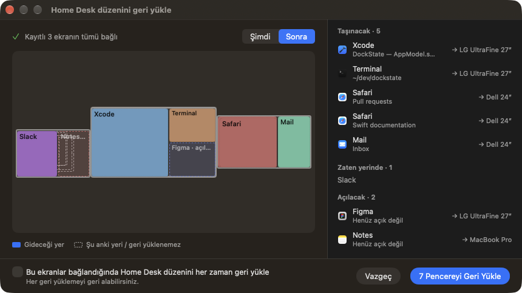
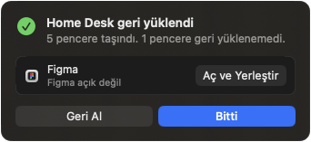
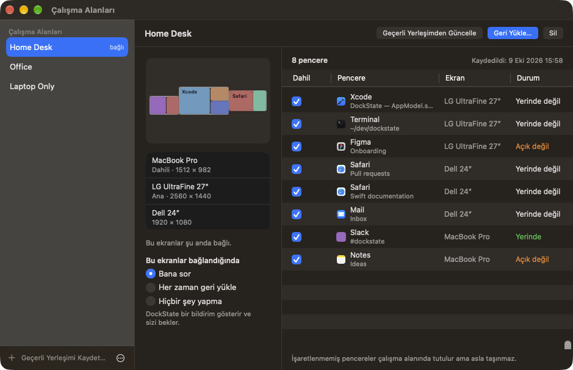
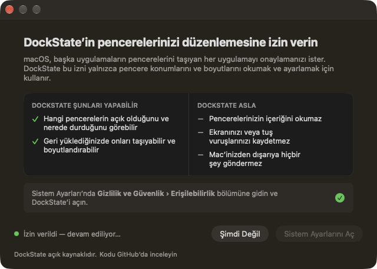
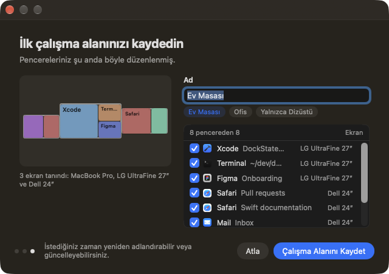
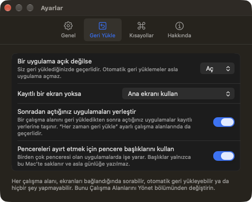
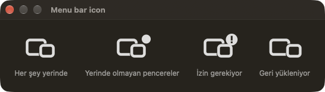

<p align="center">
  
</p>

<h1 align="center">DockState</h1>

<p align="center">
  <b>Çalışma alanınız, tam bıraktığınız yerde.</b><br>
  Her ekran düzeni için pencerelerinizin nerede durduğunu hatırlayan, yeniden bağlandığınızda onları yerine koyan küçük ve gizlilik odaklı bir menü çubuğu uygulaması.
</p>

<p align="center">
  <a href="https://github.com/KEREM-BAS/DockState/releases"></a>
  
  
  <a href="LICENSE"></a>
  <a href="https://github.com/KEREM-BAS/DockState/actions/workflows/ci.yml"></a>
</p>

<p align="center"><a href="README.md">English</a></p>

---

MacBook’unuzu iki monitöre bağlıyorsunuz. IDE büyük ekranda, tarayıcı diğerinde, mesajlaşma uygulamaları dizüstünde. Kabloları çıkarıp gidiyorsunuz; macOS her şeyi dizüstü ekranına yığıyor. Geri gelip tekrar bağladığınızda **hiçbir şey eski yerine dönmüyor** — ve haftada birkaç kez onlarca pencereyi yeniden sürüklüyorsunuz.

DockState yalnızca bu sorunu çözer:

1. **Kaydet** — pencerelerinizi bir kez düzenleyin ve bir çalışma alanı olarak kaydedin (*Ev Masası*, *Ofis*, *Yalnızca Dizüstü*…).
2. **Yeniden bağla** — DockState ekran düzeninizi tanır; monitör başka bir porta takılmış olsa bile.
3. **Geri yükle** — neyin taşınacağını görün, tek tıkla geri yükleyin, istediğiniz an **geri alın**.

Siz onay vermeden hiçbir pencere taşınmaz.

## Ekran görüntüleri

<table>
<tr>
<td width="38%" valign="top"><br><sub><b>Menü çubuğu.</b> Ekranlarınız kayıtlı bir çalışma alanıyla eşleşince DockState onu önerir — o kadar.</sub></td>
<td valign="top"><br><sub><b>Önizleme.</b> Hiçbir şey taşınmadan önce: neyin taşınacağı, neyin zaten yerinde olduğu ve neyin geri yüklenemeyeceği.</sub></td>
</tr>
<tr>
<td valign="top"><br><sub><b>Sonuç.</b> Önce başarı, sonra eksikler ve tek tıklık çözüm. Geri Al her zaman orada.</sub></td>
<td valign="top"><br><sub><b>Yönetim.</b> Ekranlar, çalışma alanı başına otomasyon ve hangi pencerelerin dahil olduğu.</sub></td>
</tr>
<tr>
<td valign="top"><br><sub><b>Açık sözlü izin ekranı.</b> DockState’in neler yapabildiği ve neleri asla yapmadığı.</sub></td>
<td valign="top"><br><sub><b>İlk çalışma alanı.</b> Hazır bir ad önerisi ve seçili tüm pencereler — tek tık.</sub></td>
</tr>
<tr>
<td valign="top"><br><sub><b>Birkaç net seçim.</b> Geri kalan her şey makul varsayılanlarla gelir.</sub></td>
<td valign="top"><br><sub><b>Menü çubuğu simgesi</b> pencereler yerinde değilse, izin eksikse ve geri yükleme sürerken bunu gösterir.</sub></td>
</tr>
</table>

<sub>Ekran görüntüleri hayali bir masayla alınmıştır (Debug derlemelerde <code>-DockStateDemo YES</code>).</sub>

## Özellikler

- **Her ekran düzeni için çalışma alanları** — istediğiniz kadar kaydedin, yeniden adlandırın, mevcut düzenden güncelleyin, tek tek pencereleri hariç tutun. Dosya olarak dışa ve içe aktarın (yedek, yeni Mac).
- **Yalnızca “2 ekran” değil, masanızı tanır** — monitörler EDID üretici/model/seri numarası, ekran UUID’si ve yerleşimle tanımlanır. Farklı porta takılan veya çözünürlüğü değişen monitör yine *sizin* monitörünüzdür; aynı modelden iki monitör konumlarıyla ayırt edilir. Fazladan bir ekran (Sidecar, projeksiyon, kapağı açmak) masanızın tanınmasını engellemez.
- **Taşımadan önce önizleme** — Şimdi / Sonra haritası ve kesin listeler: *taşınacak*, *zaten yerinde*, *geri yüklenmeyecek (ve nedeni)*.
- **Geri alma** — her pencereyi geri yükleme öncesindeki yerine koyar. Sonradan sizin taşıdığınız pencerelere dokunmaz.
- **Eksikleri açar** — bir çalışma alanını geri yüklediğinizde açık olmayan uygulamaları açar ve pencerelerini yerine koyar (sizin başlattığınız geri yüklemelerde; otomatik olanlar asla uygulama açmaz).
- **Kısmi başarısızlık sorun değil** — kapatılmış bir pencere ya da açılamayan bir uygulama nedeniyle birlikte bildirilir ve diğerlerini asla durdurmaz.
- **Otomasyonu siz seçersiniz** — her çalışma alanı için: *Bana sor* (bildirim, varsayılan), *Her zaman geri yükle* veya *Hiçbir şey yapma*. Otomatik geri yükleme yalnızca ekran düzeni gerçekten değiştiğinde olur — sıradan bir uyanma veya kilit açmada asla.
- **Sonradan açtığınız uygulamalar** — bir çalışma alanını geri yükledikten sonra açtığınız uygulama (on dakika sonra açılan Slack) da kayıtlı yerine gider. Kendi Geri Al düğmesiyle.
- **Menü çubuğu öncelikli** — gözünüzün önünden çekilir; simgeye sol veya sağ tıklayın. Pencereler yerinde değilse simgede bir nokta, izin eksikse bir rozet görünür. Bir DockState penceresi açıkken Dock’ta ve Cmd+Tab’de de görünür; pencereleri en üstte kalır (Ayarlar › Genel), böylece düzenlediğiniz uygulamaların arkasında kaybolmaz.
- **İsterseniz klavye kısayolları** — kaydet, eşleşen düzeni geri yükle, geri al. Varsayılan olarak kapalıdır (genel kısayollar her uygulamada aynı tuşları devralır); Ayarlar’dan kendi kısayollarınızı kaydedin.
- **Türkçe ve İngilizce**, uygulama içinden dil değiştirme. Yeni dillere katkı memnuniyetle karşılanır.

## Gizlilik

- **Her şey Mac’inizde kalır.** Hesap yok, bulut yok, analitik yok.
- **Ağ isteği yok** — *Ayarlar › Genel › Güncellemeleri otomatik denetle* seçeneğini açmadığınız (ya da *Şimdi Denetle*’ye basmadığınız) sürece. Açarsanız DockState günde en fazla bir kez bu deponun herkese açık sürüm akışını okur ve sizinle ilgili hiçbir şey göndermez.
- DockState, başka uygulamaların pencerelerini taşımak için macOS’un **Erişilebilirlik** iznine ihtiyaç duyar. Pencere konumlarını, boyutlarını ve başlıklarını okur; konum ve boyutları ayarlar. Pencere içeriklerini asla okumaz.
- **Ekran Kaydı izni gerekmez.** Önizlemeler ekran görüntüsü değil, şematik haritadır.
- Pencere başlıkları yalnızca `~/Library/Application Support/DockState/workspaces.json` içinde saklanır, asla günlüğe yazılmaz ve *Ayarlar › Geri Yükle* bölümünden kapatılabilir (mevcut başlıklar silinir, yenileri saklanmaz).
- *Tanılama Bilgisini Kopyala* (Ayarlar › Hakkında) hata bildirimi için pencere başlığı, uygulama adı veya seri numarası içermeyen bir özet üretir.

## Kurulum

1. [Releases](https://github.com/KEREM-BAS/DockState/releases) sayfasından en son **`DockState-x.y.z.dmg`** dosyasını indirin.
2. Açın ve **DockState**’i **Uygulamalar** klasörüne sürükleyin.
3. DockState’i başlatın ve üç adımlık kurulumu izleyin.

Developer ID ile imzalanan sürümler Apple tarafından notarize edilir ve normal şekilde açılır. `…-unsigned.dmg` adlı sürümler notarize değildir, bu yüzden macOS ilk açılışı engeller: DockState’i bir kez açın, ardından **Sistem Ayarları › Gizlilik ve Güvenlik** bölümüne gidip **Yine de Aç**’a tıklayın (macOS 14’te uygulamaya sağ tıklayıp **Aç**’ı da seçebilirsiniz). İmzasız bir sürümü güncelledikten sonra DockState’in Erişilebilirlik iznini kapatıp yeniden açın — macOS izni tam olarak o derlemeye bağlar.

**Gereksinimler:** macOS 14 Sonoma veya üzeri, Apple Silicon veya Intel.

## DockState neleri yapabilir, neleri yapamaz

DockState yalnızca Apple’ın herkese açık API’lerini kullanır — özel framework yok, SIP değişikliği yok. Bu da dürüst sınırlar getirir:

| Durum | Davranış |
| --- | --- |
| Geçerli Alan’daki normal pencereler | ✅ Kaydedilir ve geri yüklenir |
| Bir uygulamanın birden çok penceresi | ✅ Başlık, boyut, ekran ve sırayla eşleştirilir; iki pencere ayırt edilemiyorsa DockState **tahmin etmek yerine atlar** |
| Uygulama açık değil | ✅ Geri yüklediğinizde açılır ve yerleştirilir (Ayarlar › Geri Yükle › *Bir uygulama açık değilse*); otomatik geri yüklemeler bunu yalnızca bildirir |
| Geri yüklemeden sonra açılan uygulama | ✅ Otomatik yerleştirilir (Ayarlar › Geri Yükle › *Sonradan açtığınız uygulamaları yerleştir*) |
| Kaydedildikten sonra kapatılan pencere | ⏭️ Kapatıldığı bildirilir |
| Küçültülmüş pencereler | ⏭️ Küçültülmüş bırakılır ve bildirilir |
| Tam ekran pencereler | ⏭️ Dokunulmaz (tam ekran Alanlar için herkese açık API yok) |
| Diğer Alanlar’daki pencereler | ❌ Herkese açık API’ler göremez; o Alan’a geçip orada geri yükleyin |
| Kayıtlı ekran yok | Pencereler orantılı olarak ana ekrana gider ya da yerinde kalır — siz seçersiniz |
| Fazladan ekran bağlı | ✅ Masanız yine tanınır; pencereler kayıtlı ekranlarına gider |
| Çözünürlük / ölçekleme değişti | Konum ve boyutlar yeni kullanılabilir alana göre ölçeklenir |
| Yansıtılan ekranlar | Tek ekran olarak ele alınır |
| Taşınmayı reddeden veya boyut dayatan uygulamalar | Bildirilir ya da olduğu gibi kabul edilir; diğerleri yine geri yüklenir |

Ayrıntılar (İngilizce): [docs/BEHAVIOR.md](docs/BEHAVIOR.md).

## Kaynaktan derleme

```bash
git clone https://github.com/KEREM-BAS/DockState.git
cd DockState
open DockState.xcodeproj        # Xcode 26 veya üzeri, ardından Run
```

Kurulacak bağımlılık yok. Uygulama varsayılan olarak yerel çalıştırma için imzalanır; derlemeler arasında Erişilebilirlik iznini korumak için kendi ekibinizle imzalayın — bkz. [`Config/Signing.xcconfig`](Config/Signing.xcconfig).

Çekirdek mantık bir Swift paketindedir ve hiçbir izin gerektirmeden test edilir:

```bash
cd Packages/DockStateKit && swift test
```

Uçtan uca öz-test, gerçek Mac’inizde geçici bir test penceresini taşır — bkz. [docs/TESTING.md](docs/TESTING.md).

## Katkı

Hata bildirimleri, çeviriler ve pull request’ler memnuniyetle karşılanır — bkz. [CONTRIBUTING.md](CONTRIBUTING.md) ve [docs/ARCHITECTURE.md](docs/ARCHITECTURE.md). Hata bildirimlerine lütfen *Tanılama Bilgisini Kopyala* çıktısını ekleyin.

## Lisans

[MIT](LICENSE) © Kerem Baş ve DockState katkıcıları.
